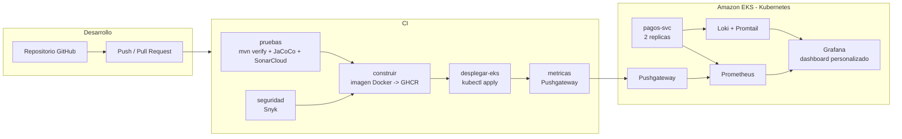

# pagos-svc — Observabilidad y entornos reales en DevOps (EP3)

Microservicio de pagos construido con **Spring Boot 3.3, Java 21 y Docker**. Este repositorio
extiende el pipeline DevOps de las evaluaciones anteriores (EP1 y EP2) para incorporar
**observabilidad, métricas, dashboards y cumplimiento automatizado**, desplegando en un entorno
orquestado real (**Amazon EKS**).

Asignatura: **Ingeniería DevOps (DOY0101)** · Evaluación Parcial N°3.

---

## 1. Arquitectura



### Flujo de datos de observabilidad

1. El microservicio expone métricas en `/actuator/prometheus` (Micrometer + Prometheus).
2. **Prometheus** raspa esas métricas cada 15 s (vía `ServiceMonitor`) y las guarda como series de tiempo.
3. **Promtail** recolecta los logs de los contenedores y los envía a **Loki**.
4. **Grafana** consulta Prometheus (métricas) y Loki (logs) para mostrar el **dashboard personalizado**.
5. Al final del pipeline, GitHub Actions publica en el **Pushgateway** las métricas de CI/CD
   (tiempo de despliegue, cobertura, estado, vulnerabilidades), que Prometheus también raspa.

---

## 2. Stack de herramientas

| Capa | Herramienta | Indicador |
| --- | --- | --- |
| Monitoreo (métricas) | **Micrometer + Prometheus** | IE1 |
| Logging | **Loki + Promtail** | IE1 |
| Dashboard | **Grafana** (dashboard personalizado) | IE3 |
| Orquestación | **Amazon EKS** (Kubernetes) | IE2 |
| Métricas CI/CD | **Prometheus Pushgateway** | IE3 |
| Calidad | **SonarCloud** (quality gate) | IE5 / IE6 |
| Seguridad | **Snyk** (vulnerabilidades) | IE6 |
| Cobertura | **JaCoCo** (100 %) | IE6 |
| Auditoría | **scripts/auditoria.sh** | IE5 |

---

## 3. Requisitos previos

- Cuenta de AWS con permisos para crear un cluster EKS.
- `awscli`, `eksctl`, `kubectl` y `helm` instalados.
- Cuenta de **SonarCloud** vinculada al repositorio (gratis para repos públicos).
- Cuenta de **Snyk** con token.

---

## 4. Puesta en marcha

### 4.1 Local (desarrollo rápido)

```bash
docker compose up --build -d
```

Levanta 2 réplicas (puertos 8080 y 8081). El endpoint de métricas queda en
`http://localhost:8080/actuator/prometheus`.

### 4.2 Crear el cluster EKS

```bash
cd infra
./setup-eks.sh
```

### 4.3 Desplegar el microservicio en EKS

```bash
# reemplaza el tag por uno real publicado en GHCR
sed -i "s/IMAGE_TAG_PLACEHOLDER/<sha>/g" k8s/deployment.yaml
kubectl apply -f k8s/namespace.yaml
kubectl apply -f k8s/deployment.yaml
kubectl apply -f k8s/service.yaml
kubectl apply -f k8s/service-monitor.yaml
```

> El `Deployment` usa la imagen de GHCR (`ghcr.io/lucasmerc20/ep02-devops`). Para que los nodos
> puedan descargarla, haz público el paquete en *GitHub → Packages → Package settings → Change
> visibility → Public*, o crea un `imagePullSecrets` llamado `ghcr-secret`.

### 4.4 Instalar el stack de observabilidad

```bash
cd observability
./setup-observabilidad.sh
```

Esto instala (vía Helm) **kube-prometheus-stack** (Prometheus + Grafana + Pushgateway) y
**loki-stack** (Loki + Promtail), registra el datasource de Loki y provisiona el dashboard
personalizado en Grafana.

### 4.5 Configurar secretos y variables en GitHub

En *Settings → Secrets and variables → Actions*:

**Secrets:**

| Nombre | Descripción |
| --- | --- |
| `SNYK_TOKEN` | Token de Snyk |
| `SONAR_TOKEN` | Token de SonarCloud |
| `AWS_ACCESS_KEY_ID` / `AWS_SECRET_ACCESS_KEY` | Credenciales AWS (con permisos sobre EKS) |
| `PUSHGATEWAY_URL` | URL externa del Pushgateway (ej. `http://a1b2c3.elb.amazonaws.com:9091`) |

**Variables:**

| Nombre | Valor de ejemplo |
| --- | --- |
| `AWS_REGION` | `us-east-1` |
| `EKS_CLUSTER_NAME` | `pagos-cluster` |
| `SONAR_ORGANIZATION` | tu organización en SonarCloud |
| `SONAR_PROJECT_KEY` | `Lucasmerc20_EP02-DEVOPS` |

---

## 5. Pipeline CI/CD

El pipeline está en `.github/workflows/pipeline.yml` y corre en cada push y pull request a
`main` y `develop`.

```
pruebas ──┐
          ├──> construir ──> desplegar-eks ──> metricas
seguridad ┘
```

| Etapa | Qué hace | Si falla… |
| --- | --- | --- |
| `pruebas` | `mvn verify` (pruebas + cobertura JaCoCo ≥ 100 %). Luego **SonarCloud** con `qualitygate.wait=true`. | El pipeline se detiene. |
| `seguridad` | **Snyk** analiza dependencias. Si hay vulnerabilidades altas/críticas falla. | El pipeline se detiene. |
| `construir` | Construye la imagen Docker y la publica en **GHCR** con el SHA del commit. | No corre si fallan las anteriores. |
| `desplegar-eks` | Conecta a EKS, aplica los manifiestos y espera el rollout. Verifica `/actuator/health`. | Solo corre en push. |
| `metricas` | Publica en **Pushgateway**: tiempo de despliegue, cobertura, estado y vulnerabilidades. | No bloquea (es informativo). |

`construir` solo corre si pasan `pruebas` y `seguridad`; `desplegar-eks` y `metricas` solo en push.

---

## 6. Métricas y dashboard (Grafana)

El dashboard **"Pagos SVC - Observabilidad"** se provisiona automáticamente. Paneles:

| Panel | Métrica Prometheus |
| --- | --- |
| Disponibilidad (up) | `up{namespace="pagos"}` |
| Estado del último despliegue | `despliegue_estado{job="ci"}` |
| Réplicas activas | `count(up{namespace="pagos"} == 1)` |
| Uso de CPU | `rate(container_cpu_usage_seconds_total{...}[5m])` |
| Uso de memoria | `container_memory_working_set_bytes{...}` |
| Tasa de peticiones | `rate(http_server_requests_seconds_count{...}[5m])` |
| Errores (HTTP 5xx) | `rate(http_server_requests_seconds_count{status=~"5.."}[5m])` |
| Latencia p95 | `histogram_quantile(0.95, ...)` |
| Tiempo de despliegue | `despliegue_duracion_segundos{job="ci"}` |
| Cobertura de pruebas | `cobertura_porcentaje{job="ci"}` |
| Vulnerabilidades bloqueadas | `snyk_vulnerabilidades{job="ci"}` |
| Logs | Loki: `{namespace="pagos"}` |

Estas métricas permiten **tomar decisiones técnicas**: si la latencia o los errores suben, o si la
cobertura baja, el equipo lo ve de inmediato y puede actuar antes de un problema mayor.

---

## 7. Cumplimiento y seguridad (IE5 / IE6)

- **SonarCloud**: análisis estático de calidad con *quality gate*. El pipeline espera el resultado
  y se detiene si el gate no se cumple.
- **Snyk**: detiene el pipeline ante vulnerabilidades altas o críticas.
- **JaCoCo**: exige 100 % de cobertura; si baja, `mvn verify` falla.
- **Branch protection** (en GitHub → Settings → Branches, sobre `main` y `develop`):
  - Requerir pull request antes de fusionar.
  - Requerir revisión/aprobación.
  - Requerir que pasen los checks del pipeline.
- **Auditoría automatizada** (`scripts/auditoria.sh`): busca secretos commiteados, verifica que la
  imagen esté versionada y que Snyk, SonarCloud y Prometheus estén integrados.

### Demostración de detención del pipeline (IE6)

Ante una **falla crítica** (prueba rota, cobertura < 100 %, vulnerabilidad alta, o quality gate de
SonarCloud en rojo), el job correspondiente termina en error y `construir`/`desplegar-eks` **no se
ejecutan**, protegiendo el entorno productivo. Esto se puede demostrar introduciendo, por ejemplo,
una vulnerabilidad en `pom.xml` o bajando la cobertura de una clase.

---

## 8. Modelo de ramificación (GitFlow)

Se mantiene el modelo elegido en la EP1:

| Rama | Origen | Propósito | ¿Se borra? |
| --- | --- | --- | --- |
| `main` | inicial | Código estable, listo para producción | No |
| `develop` | main | Integración de features | No |
| `feature/<nombre>` | develop | Un cambio de funcionalidad | Sí, al fusionarse |
| `hotfix/<nombre>` | main | Corrección urgente | Sí, al fusionarse |

Convención de commits: `tipo(alcance): descripcion-corta` (minúsculas, sin tildes).

---

## 9. Declaración de uso de IA

Se utilizó **OpenCode (DeepSeek)** únicamente como guía para orientar el desarrollo del encargo y
para la elaboración de los diagramas de arquitectura. El resto del trabajo fue desarrollado y
validado por el equipo, y las conclusiones y reflexiones fueron redactadas **sin apoyo de IA**.
Normativa: https://bibliotecas.duoc.cl/ia

---

## 10. Conclusiones y reflexión personal

Fue un desafío muy interesante y trabajado, sinceramente sin ayuda no se habría conseguido.
